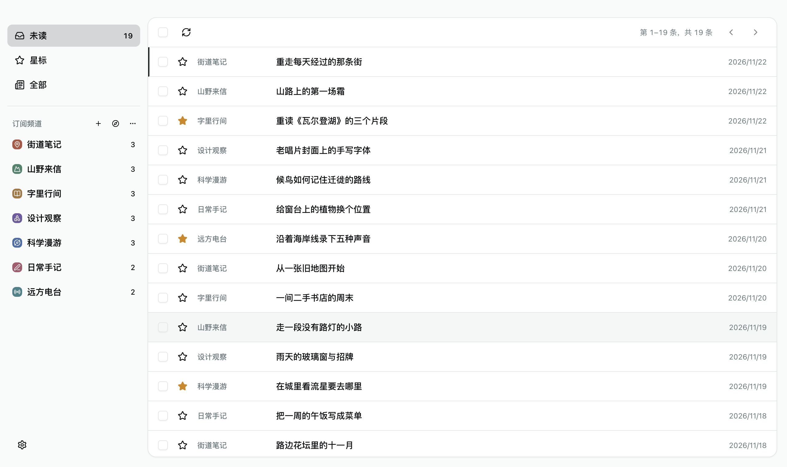

# 一刊 · Yikan

一刊是一款桌面 RSS 和 Atom 阅读器。订阅你喜欢的博客、媒体和独立网站，在一个地方阅读它们的更新。

适用于 macOS、Windows 和 Linux。[下载一刊](https://github.com/xwcoder/yikan/releases) · [反馈问题](https://github.com/xwcoder/yikan/issues/new)

